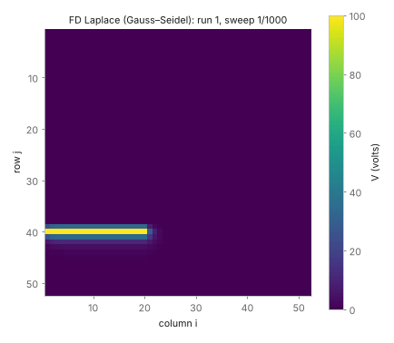

# Shielded strip line — capacitance and characteristic impedance (FD Laplace solver)

**File:** `TMLimpedance.m` (original, unmodified)
**Method:** Finite-Difference Method for Laplace's equation, solved by Gauss–Seidel iteration (in-place 5-point averaging). The charge comes from Gauss's law and Z0 from the capacitances.



[MP4 version](media/laplace_microstrip_convergence.mp4). The animation shows the potential every 10 sweeps, which is what the script showed live with `imagesc`/`drawnow`.

## Problem
Quasi-TEM analysis of a strip conductor in a rectangular shield, partly filled with a dielectric:

```
∇²V = 0 in each region
Interface (row of the strip):  V0 = ε1/(2(ε1+ε2))·V_above + ε2/(2(ε1+ε2))·V_below + ¼(V_left + V_right)
C  = Q/V with the dielectric,  C0 = Q/V in air
Z0 = 1 / ( c · √(C·C0) )
```

## Model as coded
| Item | Value |
|---|---|
| Grid | h = 0.05, 52 × 52 nodes (a = b = 2.5) |
| Strip | row 40 (a − d = 2.0), columns 1–20 (half-width w = 1), V = 100 V |
| Dielectric | εr = 2.35 below the strip row, air above |
| Shield (0 V) | top row and the right-hand columns |
| Symmetry planes (∂V/∂n = 0) | left column (i = 1) and bottom row (j = n) |
| Capacitance | quarter model, so C = 4Q/V |
| Charge | Gauss's law: the difference of ε·V summed over two adjacent rectangular contours around the strip |
| Iterations | 1000 Gauss–Seidel sweeps per case |

## Result
Running the current file gives C = 5.226·10⁻¹¹ F/m, C0 = 5.273·10⁻¹¹ F/m and **Z0 = 63.50 Ω**. This matches the original MATLAB screenshot `Snap77.jpg`.
GNU Octave running the unmodified file gives the same numbers.

Original MATLAB screenshots: [`original_matlab_screenshots/`](original_matlab_screenshots). `Snap76.jpg` is from an earlier version of the script (500 iterations, Z0 = 54.56 Ω).

## Notes (left as in the original)
- **The dielectric is switched off after the first sweep.** The `for q=1:iteration` loop is only closed by the second-to-last `end`. The plotting, the charge calculation and the lines
  `E1=E0; E2=E0;` all sit inside the iteration loop. After sweep 1 both runs are effectively air-filled, which is why C ≈ C0 and the two figures (“with” and “without dielectric”) look almost the same.
  Closing the `q` loop right after the sweep (after the inner `for j` loop) would keep εr = 2.35 for the first case.
- In the interface update `v(j,i+1) = o*v(j-1,i) + L*v(j+1,i) + ¼(v(j,i) + v(j,i+3))`, the neighbours of node (j, i+1) should be (j±1, i+1), (j, i) and (j, i+2).
- The bottom row is treated as a symmetry plane. For a microstrip with a ground plane under the substrate, that row would be held at 0 V instead.
- Plain Gauss–Seidel converges slowly on this grid, which is why 500 and 1000 sweeps give noticeably different Z0. Successive over-relaxation (SOR) would converge much faster.
