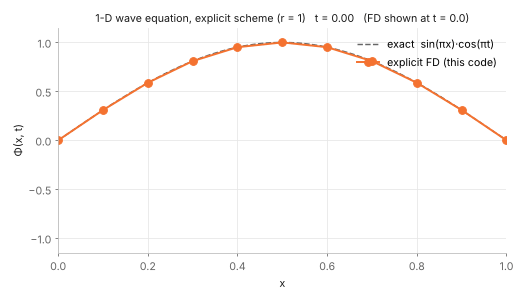

# 1-D wave equation — explicit central-difference scheme

**File:** `adadi2_explicit_.m` (original, unmodified)
**Method:** Explicit finite difference (central in time and space, leap-frog)



[MP4 version](media/wave_explicit.mp4)

## Problem
A vibrating string with fixed ends:
```
∂²Φ/∂t² = u² ∂²Φ/∂x²,   0 < x < 1,  u = 1
Φ(0,t) = Φ(1,t) = 0,  Φ(x,0) = sin(πx),  ∂Φ/∂t(x,0) = 0
```

## Scheme
With r = (u·dt/dx)² = 1:

```
Φ(i, j+1) = Φ(i−1, j) + Φ(i+1, j) − Φ(i, j−1)
```

For the first step, the zero initial velocity gives Φ(i,1) = ½[Φ(i−1,0) + Φ(i+1,0)].
dx = 0.1 and dt = 0.1, with 10 time levels.

## Result
At r = 1 (Courant number 1, the "magic time step") the scheme reproduces the exact solution sin(πx)·cos(πt) at every node.
The computed values match it to machine precision (≈ 3·10⁻¹⁶). In the animation, the dashed curve moves continuously and the dots show the finite-difference time levels.
