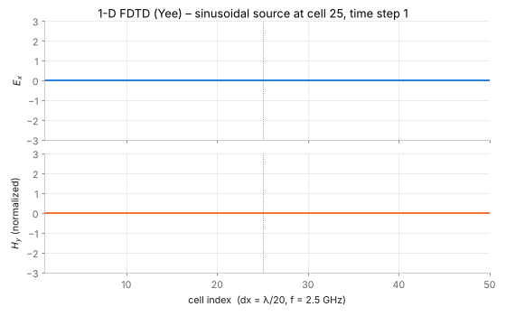

# 1-D FDTD — plane-wave propagation (Ex, Hy)

**File:** `oneDimention.m` (original, unmodified)
**Method:** Finite-Difference Time-Domain (Yee leap-frog scheme) in normalized form



[MP4 version](media/fdtd_1d_propagation.mp4)

## What it solves
Maxwell's curl equations for a wave travelling along one axis, with field components Ex and Hy:

```
Ex(j) <- Ex(j) + cc * (Hy(j-1) - Hy(j))
Hy(j) <- Hy(j) + cc * (Ex(j) - Ex(j+1))
```

E and H are updated alternately in time (leap-frog) on staggered grid points. H is normalized, so both updates share the same coefficient `cc`.

## Parameters
| Quantity | Value |
|---|---|
| Frequency | f = 2.5 GHz (λ0 = 12 cm) |
| Cell size | dx = λ0/20 = 6 mm |
| Time step | dt = dx/(2c0) = 10 ps, so the Courant number is cc = c0·dt/dx = 0.5 |
| Grid | ke = 50 cells |
| Source | hard sinusoidal source `Ex(25) = sin(2πf(t−1)dt)` at the centre |
| Duration | 500 time steps |

## Boundary condition
This is a **simple absorbing boundary condition (ABC)**, not a PEC wall and not a PML.
Each boundary value is copied from its neighbour two time steps earlier:

```
Ex(1)  = Ex(2)    at time step t-2
Ex(ke) = Ex(ke-1) at time step t-2
Hy(ke) = Hy(ke-1) at time step t-2
```

With cc = 0.5 a wave moves half a cell per step, so it needs exactly two steps to cross one cell. That makes this boundary reflection-free in 1-D (the classic
"two-step" ABC). The history buffer `X` stores the values from earlier steps.

## Notes (left as in the original)
- `sikma`, `pmb` and `e0` are defined but not used.
- The Ex boundary assignment sits inside the update loop, so it is repeated every iteration. The result is the same.
- The Hy loop runs to `j = ke` and reads `Ex(ke+1)`, which always stays zero. `Hy(ke)` is then overwritten by the boundary value.
