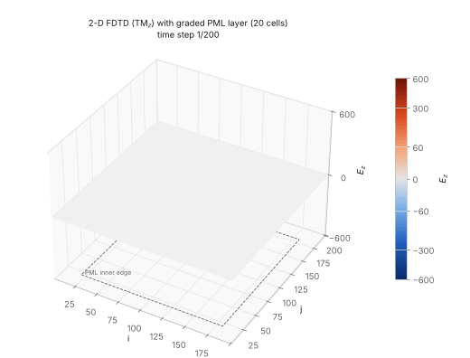

# 2-D FDTD with a graded PML absorbing layer (TMz)

**File:** `PML.m` (original, unmodified)
**Method:** 2-D Finite-Difference Time-Domain, TMz (Ez, Hx, Hy), surrounded by a **graded perfectly-matched (lossy) layer**. The electric conductivity σ and the magnetic conductivity σ* are matched (σ*/μ0 = σ/ε0) and follow a 6th-order polynomial grading.

### 3-D surface view


[MP4 version](media/fdtd_2d_pml_3d.mp4)

### Top view


[MP4 version](media/fdtd_2d_pml.mp4). The dashed square is the inner edge of the 20-cell layer. The left panel shows every node, the right panel every second node (the active sub-lattice).

## Absorbing layer
| Quantity | Value in the code |
|---|---|
| Layer width | `bound_width = 20` cells on all four sides |
| Grading | polynomial of order `gradingorder = 6`, integrated over each cell: σ(z) ∝ (z+½)⁷ − (z−½)⁷ |
| Design reflection | `refl_coeff = 1e-6` → σ_max = −log₁₀(R)·(m+1)·ε0·c0 / (2·w·Δ) |
| Matching | σ* = σ·μ0/ε0 (so the layer impedance equals free space at normal incidence) |
| Corners | the x- and y-profiles are added (σ3 = σ + σ1 + σ2) |


Semi-implicit (time-averaged) loss coefficients:

```
H:  A = (μ − ½Δt σ*)/(μ + ½Δt σ*),   B = (Δt/Δ)/(μ + ½Δt σ*)
E:  C = (ε − ½Δt σ )/(ε + ½Δt σ ),   D = (Δt/Δ)/(ε + ½Δt σ )

Ez ← C·Ez + D·[Hy(j,i+1) − Hy(j,i−1) − Hx(j+1,i) + Hx(j−1,i)]
Hx ← A·Hx − B·[Ez(j+1,i) − Ez(j−1,i)]
Hy ← A·Hy + B·[Ez(j,i+1) − Ez(j,i−1)]
```

Outside the layer σ = 0, so A = C = 1 and B·D = (cΔt/Δ)² = 0.25: the ordinary lossless update in physical (non-normalized) units.

## Other parameters
f = 10 GHz, Δ = 0.75 mm, Δt = Δ/(2c0), a 201 × 201 grid, 200 steps. The source is a short line `Ezz(98:103, 100)` (6 cells) driven with 1000·sin(2πf(t−1)Δt).
The lossy rod from the earlier scripts is still defined at (25, 25), which now lies inside the absorbing layer.

## Result
The cylindrical wave leaves the source and is strongly attenuated inside the layer. To check this, I compared the run with a reference on a 3× larger grid (same scheme, no boundary within reach). The residual reflection in the interior is about 5–9 % of the direct field near the end of the run. Without the layer, the PEC edges reflect the wave completely. This is the working PML version; [`2D_FDTD_PML_draft`](../2D_FDTD_PML_draft) is the earlier split-field attempt.

## Notes (left as in the original)
- This is a *matched lossy layer* (σ and σ* in the ordinary, non-split equations), not Bérenger's split-field PML. It is reflectionless at normal incidence; at oblique incidence a small reflection remains.
- σ_max is multiplied by an extra factor `1e03`, and the formula uses log₁₀ instead of ln. The resulting σ is so large (up to ≈ 3.7·10³ S/m, and twice that in the corners) that ½Δtσ ≫ ε in the outer ~12 cells, which drives C (and A) towards −1.
  The absorption happens mainly in the first, more gently graded cells of the layer.
- The same non-staggered central differences as in the other 2-D scripts: the field lives on every second node and the wave speed comes out at 2c0.
- Inside the rod both the `Ca/Cb` update (normalized units) and the `C/D` update (physical units) are applied. The second one dominates.
- The edges of the grid stay at 0 (PEC) behind the layer.
