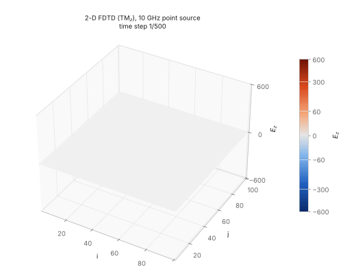

# 2-D FDTD — TMz propagation from a point source (Ez, Hx, Hy)

**File:** `twooooooD1.m` (original, unmodified)
**Method:** 2-D Finite-Difference Time-Domain, TMz polarization, with lossy-medium update coefficients


[MP4 version](media/fdtd_2d_propagation.mp4)

*Left: Ez at every grid node, as the script computes it (the original plotted it with `mesh`). Right: Ez on every second node, which shows the circular wavefronts clearly (see the notes below). The grey circle marks the dielectric rod.*

### 3-D surface view (like the original `mesh(Ezz)` plot)

The surface shows the active sub-lattice (every second node), with the same colour scale as all the other field animations.



[MP4 version](media/fdtd_2d_propagation_3d.mp4)

## What it solves
The TMz field set (Ez, Hx, Hy) on a 101 × 101 grid:

```
Ez <- Ca·Ez + Cb·[ Hy(j,i+1) − Hy(j,i−1) − Hx(j+1,i) + Hx(j−1,i) ]
Hx <- Hx − [ Ez(j+1,i) − Ez(j−1,i) ]
Hy <- Hy + [ Ez(j,i+1) − Ez(j,i−1) ]
```

`Ca`, `Cb` (inside the rod) and `Caa`, `Cbb` (free space) are the standard lossy-medium FDTD coefficients, built from εr and σ.

## Parameters
| Quantity | Value |
|---|---|
| Frequency | f = 10 GHz |
| Cell size | d = λd/20 with λd computed for εr = 4, so d = 0.75 mm |
| Time step | dt = d/(2c0) = 1.25 ps |
| Grid | 101 × 101 nodes (ke = 100) |
| Source | hard sinusoidal point source, amplitude 1000, at node (50, 50) |
| Scatterer | rod of radius √20 ≈ 4.5 cells centred at (25, 25), εr = 4, σ = 1 S/m |
| Duration | 500 time steps |

## Boundary conditions — what the code actually does
There is **no PML** in this file. The four walls behave differently:

| Wall | Treatment | Behaviour |
|---|---|---|
| Left / right (columns 1 and 101) | Ez copied from the neighbouring column two steps earlier (the same two-step ABC as the 1-D code) | approximate **absorbing** boundary |
| Top / bottom (rows 1 and 101) | Ez is never updated there and stays 0. Hx and Hy are set to 1/3 × the neighbour value from two steps earlier | Ez = 0 makes these walls act as **PEC (electric walls)** |

So the domain is a parallel-plate region: two PEC walls and two (approximately) open sides.

## Notes (left as in the original)
- **Non-staggered grid.** The spatial derivatives are central differences across two cells (`i+1` and `i−1`) with all fields on the same nodes. A standard Yee grid uses half-cell staggering instead.
  This splits the grid into independent sub-lattices (odd–even decoupling). The source excites only every second node, and the boundary updates leak into the other sub-lattice.
  That is why the raw field (left panel) looks striped.
- Because the differences span 2·d while the coefficients assume d, the simulated wave speed is d/dt = 2c0. The wavelength comes out at about 80 cells instead of the intended 40.
- Inside the rod both updates run one after the other (the `if` block and then the general line). The effective coefficient is therefore 0.0625 + 0.25 = 0.3125 instead of 0.0625, so the rod does not behave as εr = 4.
- `R = d/2*e0` evaluates to (d/2)·ε0 ≈ 3·10⁻¹⁵, which makes the loss terms negligible (Ca ≈ Caa ≈ 1). The usual loss factor is σ·dt/(2ε).
- `X = zeros(nstep,nstep,nstep)` allocates 500³ doubles (≈ 1 GB), but only `X(1:101, t, 1:6)` is used.
- `X(i,t,4) = Hy(i,ke-1)` has its indices swapped compared with the other history lines (`Hy(ke,i)` was probably intended).
- `e0 = 8.81e-12` should be 8.854e-12 (also in the other scripts).
