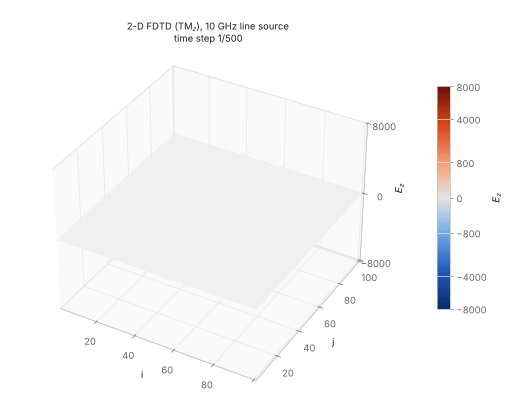

# 2-D FDTD — plane waves from a line source (TMz)

**File:** `twooooooD.m` (original, unmodified)
**Method:** 2-D Finite-Difference Time-Domain, TMz polarization (Ez, Hx, Hy). This is a variant of [`twooooooD1.m`](../2D_FDTD_TMz_Ez) that uses a line source instead of a point source.

[MP4 version](media/fdtd_2d_line_source.mp4)

*Left: Ez at every grid node, as computed (the original plotted it with `mesh`). Right: every second node (the active sub-lattice), where the plane wavefronts are clear. The grey circle marks the dielectric rod.*

### 3-D surface view (like the original `mesh(Ezz)` plot)

The surface shows the active sub-lattice (every second node), with the same colour scale as all the other field animations.

[MP4 version](media/fdtd_2d_line_source_3d.mp4)

## Differences from `twooooooD1.m`
| | `twooooooD1.m` | `twooooooD.m` (this file) |
|---|---|---|
| Source | point source at (50, 50) | **line source** `Ezz(2:end-2, 50)`: the whole column 50 (rows 2–99) is driven, which launches plane waves to the left and right |
| H-field history boundary | top/bottom rows | **left/right columns** (`Hx(j,1)`, `Hx(j,ke+1)`, `Hy(j,1)`, `Hy(j,ke)`) |

Everything else is the same: f = 10 GHz, d = 0.75 mm, dt = d/(2c0), a 101 × 101 grid, 500 steps, and a lossy rod (εr = 4, σ = 1 S/m) at (25, 25).

## Boundary conditions as coded
- **Left/right:** Ez is copied from the neighbouring column two steps earlier, and Hx/Hy are set to 1/3 × their neighbour from two steps earlier. This is an approximate **absorbing** boundary for the outgoing plane waves.
- **Top/bottom:** Ez is never updated there and stays 0, so these walls act as **PEC**. Together this makes a parallel-plate waveguide carrying a TEM-like plane wave.

## Notes (left as in the original)
- `Hy(j,ke)` (not `Hy(j,ke+1)`) is overwritten by the boundary value, so the last interior column of Hy is replaced.
- The ABC is not perfect and the source keeps driving, so reflected waves build up over time.
- The same remarks as for `twooooooD1.m` apply: non-staggered central differences (odd–even decoupling and a wave speed of 2c0), the double update inside the rod, a negligible loss term, and the large `X` array.
