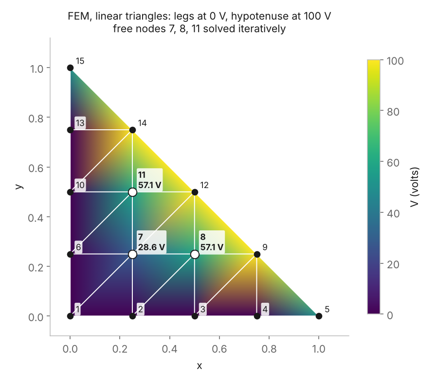

# FEM — Laplace equation with linear triangular elements

**File:** `FEM1.m` (original, unmodified)
**Method:** Finite-Element Method (variational/Galerkin) with first-order triangles. The global coefficient matrix is assembled by hand and solved iteratively (Gauss–Seidel on the free nodes).

## Problem
Laplace's equation ∇²V = 0 on a right-angled triangular region meshed with **15 nodes and 16 elements** (node spacing 0.25):

- the two legs are held at 0 V and the hypotenuse at 100 V (corner nodes 5 and 15 = 50 V)
- the free nodes are 7, 8 and 11

## Steps in the code
1. **Element data:** matrix `e` holds, for each element, Pᵢ = y_j − y_k and Qᵢ = x_k − x_j for its three local nodes.
2. **Element area:** A = (P₂Q₃ − P₃Q₂)/2.
3. **Element coefficient matrix:** C⁽ᵉ⁾ᵢⱼ = (PᵢPⱼ + QᵢQⱼ)/(4A).
4. **Assembly:** the global matrix `Ct` (15 × 15) is written out from the local-to-global node mapping (upper triangle), then made symmetric.
5. **Solution:** iterative update of each free node, Vₖ = −(1/Cₖₖ) Σ_{i≠k} Vᵢ Cᵢₖ, for 10 sweeps.

## Result
| Node | V (this code) | Direct solve (check) |
|---|---|---|
| 7 | 28.571 V | 200/7 = 28.571 V |
| 8 | 57.143 V | 400/7 = 57.143 V |
| 11 | 57.143 V | 400/7 = 57.143 V |

Nodes 8 and 11 are equal by symmetry about the line y = x. The figure shows the mesh reconstructed from the node mapping in `Ct`, coloured with the computed potentials.

## Notes (left as in the original)
- `/4*A(j,2)` evaluates as (… /4)·A rather than (…)/(4A). All elements here have the same area, so this only scales the whole matrix and the solution is unaffected.
- The two `sum(Ct(1,:))` lines and `b = Ct(:,7)` are unused leftovers.
