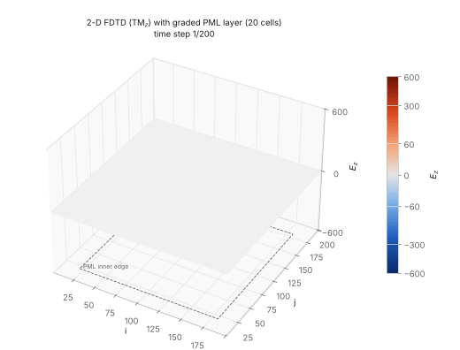

# Numerical Methods in Electromagnetics

MATLAB projects from my master's coursework in computational electromagnetics: finite-difference time-domain (FDTD), finite-difference (FDM) and finite-element (FEM) methods.
The `.m` files are the original, unmodified scripts. Each folder has a README with the method, parameters, results and notes on the code, plus animations where useful.

## FDTD — Finite-Difference Time-Domain
| Folder | Topic |
|---|---|
| [1D_FDTD](FDTD/1D_FDTD) | 1-D plane-wave propagation (Ex, Hy) with a two-step absorbing boundary |
| [2D_FDTD_TMz_Ez](FDTD/2D_FDTD_TMz_Ez) | 2-D TMz propagation from a point source, with a lossy dielectric rod |
| [2D_FDTD_line_source](FDTD/2D_FDTD_line_source) | 2-D TMz plane waves from a line source (parallel-plate region) |
| [2D_FDTD_PML](FDTD/2D_FDTD_PML) | 2-D TMz with a graded perfectly-matched absorbing layer |

## FDM — Finite-Difference Method
| Folder | Topic |
|---|---|
| [Laplace_strip_line_impedance](FDM/Laplace_strip_line_impedance) | Shielded strip line: capacitance and Z0 from a Gauss–Seidel Laplace solver |
| [Wave_equation_explicit](FDM/Wave_equation_explicit) | 1-D wave equation with an explicit central-difference scheme |

## FEM — Finite-Element Method
| Folder | Topic |
|---|---|
| [Laplace_triangular_elements](FEM/Laplace_triangular_elements) | Laplace equation on a triangular region with linear triangular elements |
| [Waveguide_cutoff_TM11](FEM/Waveguide_cutoff_TM11) | TM11 waveguide cutoff estimate (Helmholtz eigenproblem) |

## Running the code
The scripts run in MATLAB; the FDM and FEM scripts were also checked in GNU Octave. Some FDTD scripts use `moviein`/`getframe`, which are deprecated in recent MATLAB versions.
